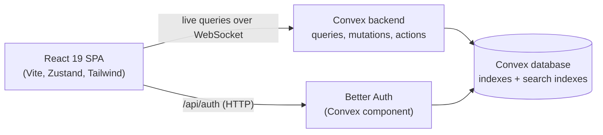

# Anjam

A real-time, multi-tenant task manager for small teams. Built with React 19, TypeScript, and Convex.

Anjam ("done" in Persian) is Persian-first. The whole UI is in Persian, laid out right-to-left, and dates use the Jalali (Persian) calendar. The code, schema, and developer docs are in English.

## Background

Anjam started in 2025 with a Go + PocketBase backend. In January 2026 I moved the backend to Convex. Convex gives reactive queries, so every open client sees changes in real time. It also removed a REST layer, a hand-written cache, and a server to maintain. The [changelog](./CHANGELOG.md) has the details.

## What it does

- **Organizations.** Each team works in its own organization. All data is scoped to an organization. A user can belong to several. Roles are `owner` and `member`.
- **Invites.** Owners create invite links with an optional expiry and use limit.
- **Projects.** Each project has a short code. Tasks get readable IDs such as `ABC-001`, numbered per project.
- **Tasks.** Title, description, status (`todo`, `in_progress`, `in_review`, `done`, `cancelled`), priority (`low` to `urgent`), deadline, tags, story points, time estimate, and assignee. Deletes are soft deletes.
- **Views.** Paginated list, drag-and-drop Kanban board, and a calendar view.
- **Filters.** Filter tasks by status, priority, assignee, project, and tags. Save filter sets and reuse them. Saved filters are stored in the browser.
- **Bulk actions.** Update or delete many tasks at once.
- **Subtasks.** Checklist items on a task, each with its own assignee.
- **Comments.** Threaded replies, `@mentions`, and reactions.
- **Notifications and inbox.** In-app notifications, plus an inbox with tasks assigned to you, tasks where you are mentioned, and recent changes to tasks you created.
- **Insights.** Weekly created and completed counts, work in progress, and cycle time, shown with charts.
- **Search.** Full-text search on task titles and on project names and codes. A command menu (`cmdk`) gives fast navigation.
- **Auth.** Email and password through Better Auth. Rate limits on sign-in and sign-up are configurable.
- **Themes.** Light and dark mode.

## Architecture



Main choices:

- **Convex as the backend.** Queries are reactive, so the UI updates when data changes. There is no REST layer, no cache invalidation code, and the generated types connect the frontend to the schema.
- **Tenant isolation in one place.** Every query and mutation calls helpers in `convex/lib/auth.ts` (`requireOrgMembership`, `requireProjectAccess`, `requireTaskAccess`). The helpers check membership before any data is read or written.
- **Denormalized `organizationId` on tasks.** Org-level queries use an index and do not join through projects.
- **Per-project counters.** A `projectCounters` table gives each task a sequential number without gaps in the display ID.
- **Better Auth as a Convex component.** Auth data lives in the same deployment. In development, Vite proxies `/api/auth` so cookies work on localhost.
- **Static frontend.** The production build is a static bundle. The `Dockerfile` serves it with nginx. The Convex URL is set at build time.
- **Route-level code splitting.** Pages load lazily. Heavy libraries (charts, drag-and-drop, icons) have their own chunks.

## Tech stack

| Area     | Tools                                                                           |
| -------- | ------------------------------------------------------------------------------- |
| Frontend | React 19, TypeScript 5.9, Vite 7, React Router 7, Zustand, React Hook Form, Zod |
| UI       | Tailwind CSS 4, Radix UI / shadcn/ui, dnd-kit, Recharts, cmdk, Sonner           |
| Locale   | `date-fns-jalali`, `@persian-tools/persian-tools`, RTL layout                   |
| Backend  | Convex (database, functions, search indexes), Better Auth                       |
| Quality  | ESLint, Prettier, Vitest, Testing Library, Playwright, Husky, lint-staged       |
| Tooling  | Bun, Docker (multi-stage build, nginx), CircleCI                                |

## Quick start

You need [Bun](https://bun.sh) 1.x and a free [Convex](https://www.convex.dev) account.

```bash
# 1. Install dependencies
bun install

# 2. Create a Convex dev deployment. This asks you to log in on first run.
#    It writes CONVEX_DEPLOYMENT and VITE_CONVEX_URL to .env.local.
#    Stop it with Ctrl+C after the first push succeeds.
bunx convex dev

# 3. Set the backend environment variables on the Convex deployment
bunx convex env set SITE_URL http://localhost:4112
bunx convex env set BETTER_AUTH_SECRET "$(openssl rand -base64 32)"

# 4. Start Convex and Vite together
bun run dev
```

Open <http://localhost:4112>.

`SITE_URL` and `BETTER_AUTH_SECRET` are required. The backend throws on start without them.

### Seed demo data

The internal `seed:seedDevData` action creates two demo organizations, five users, one project, and one tag. The end-to-end tests use this data.

The action refuses to run unless the deployment has `ALLOW_DEV_SEED=true`. Set it on development deployments only, and never on production.

```bash
bunx convex env set ALLOW_DEV_SEED true
bunx convex run seed:seedDevData '{"reset": true}'
```

Demo logins (for example `admin@example.com`) are listed in `convex/seed.ts`. The action is internal, so a client cannot call it. Run it on development deployments only, because `reset` deletes the demo organizations.

## Configuration

There are two places for variables. Frontend variables go in `.env.local` (Vite reads them). Backend variables go on the Convex deployment with `bunx convex env set`.

Frontend (`.env.local`):

| Variable               | Required | Purpose                                                                     |
| ---------------------- | -------- | --------------------------------------------------------------------------- |
| `CONVEX_DEPLOYMENT`    | yes      | Deployment name. Written by `convex dev`.                                   |
| `VITE_CONVEX_URL`      | yes      | Convex API URL. Baked into the build.                                       |
| `VITE_CONVEX_SITE_URL` | no       | Convex HTTP actions URL. Defaults to `VITE_CONVEX_URL` with `.convex.site`. |

Backend (Convex environment):

| Variable                                         | Required | Default          | Purpose                                                           |
| ------------------------------------------------ | -------- | ---------------- | ----------------------------------------------------------------- |
| `SITE_URL`                                       | yes      |                  | Public URL of the frontend. Used for auth origin checks and CORS. |
| `BETTER_AUTH_SECRET`                             | yes      |                  | Session signing secret.                                           |
| `AUTH_REQUIRE_EMAIL_VERIFICATION`                | no       | `false`          | Set `true` to require verified email.                             |
| `AUTH_RATE_LIMIT_ENABLED`                        | no       | on in production | Turn auth rate limits on or off.                                  |
| `AUTH_RATE_LIMIT_WINDOW_SECONDS` / `_MAX`        | no       | `60` / `120`     | Global limit.                                                     |
| `AUTH_SIGNIN_RATE_LIMIT_WINDOW_SECONDS` / `_MAX` | no       | `900` / `5`      | Sign-in limit.                                                    |
| `AUTH_SIGNUP_RATE_LIMIT_WINDOW_SECONDS` / `_MAX` | no       | `3600` / `10`    | Sign-up limit.                                                    |

## Scripts

| Command                 | What it does                                                                 |
| ----------------------- | ---------------------------------------------------------------------------- |
| `bun run dev`           | Convex dev and Vite dev server on port 4112                                  |
| `bun run build`         | Production build to `dist/`                                                  |
| `bun run start`         | Preview the production build                                                 |
| `bun run check`         | Type check, lint, and format check                                           |
| `bun run fix`           | Auto-fix lint and format issues                                              |
| `bun run test:run`      | Unit tests, once                                                             |
| `bun run test:coverage` | Unit tests with a coverage report                                            |
| `bun run test:e2e`      | Playwright end-to-end tests                                                  |
| `bun run build:deploy`  | Deploy Convex functions, then build the frontend (needs `CONVEX_DEPLOY_KEY`) |

## Tests

**Unit tests** use Vitest, jsdom, and Testing Library. Test files sit next to the code as `*.test.ts(x)`. They cover the permission helpers (`src/lib/permissions.ts`), utility functions (`src/lib/utils.ts`), and the `Badge` component.

**Backend tests** use [`convex-test`](https://docs.convex.dev/testing/convex-test) and run with the unit tests. `convex/tenancy.test.ts` checks tenant isolation (a member of one organization cannot read or change another organization's projects and tasks), per-project task numbering, and the owner and member edit rules.

```bash
bun run test:run
bun run test:coverage
```

**End-to-end tests** use Playwright with Chromium. Specs are in `e2e/specs/`, grouped by area: auth, organization, projects, tasks, comments, tags, notifications, calendar, bulk actions, saved filters, settings, and more. Page objects are in `e2e/pages/`. Many specs are smoke tests that check a page loads. A few are skipped where the feature does not exist.

The tests need a running dev backend with seeded data. Playwright starts `bun run dev` for you.

```bash
bunx playwright install chromium
bunx convex env set ALLOW_DEV_SEED true
bunx convex run seed:seedDevData '{"reset": true}'
bun run test:e2e
```

**CI** (CircleCI) runs type check, lint, and unit tests on every push. It does not run the e2e suite.

## Deploy

The frontend is a static site. Build it with the Convex URL set:

```bash
VITE_CONVEX_URL="https://<your-deployment>.convex.cloud" bun run build
```

Or build the Docker image (nginx serves `dist/` with an SPA fallback):

```bash
VITE_CONVEX_URL="https://<your-deployment>.convex.cloud" docker compose up --build
```

Deploy the backend with `bunx convex deploy`. Set `SITE_URL` and `BETTER_AUTH_SECRET` on the production deployment first. More detail is in [docs/operations/runbook.md](./docs/operations/runbook.md).

## Project structure

```
convex/                 Backend
  schema.ts             Tables and indexes
  tasks.ts, projects.ts, comments.ts, ...   Queries and mutations, one file per domain
  lib/auth.ts           Org membership and access checks
  auth.ts, http.ts      Better Auth setup and HTTP routes
  seed.ts               Dev seed data (development only)
src/
  pages/                Route components (auth, tasks, projects, insights, settings, ...)
  components/           UI components, grouped by feature; ui/ holds shadcn primitives
  hooks/                Data hooks that wrap Convex queries and mutations
  store/                Zustand stores (app context, filters, preferences)
  constants/            UI strings (Persian)
  lib/                  Permissions, date utilities (Jalali), helpers
e2e/                    Playwright specs, page objects, fixtures
docs/                   Development, operations, and QA notes
```

## Documentation

- [Development guide](./docs/development/guide.md)
- [Frontend architecture](./docs/development/frontend-architecture.md)
- [Operations runbook](./docs/operations/runbook.md)
- [Changelog](./CHANGELOG.md)

## License

MIT. See [LICENSE](./LICENSE).
